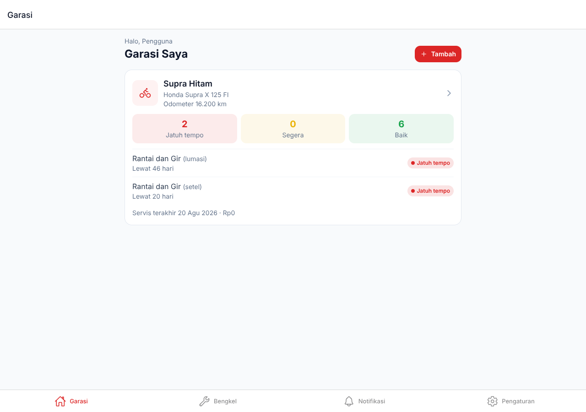
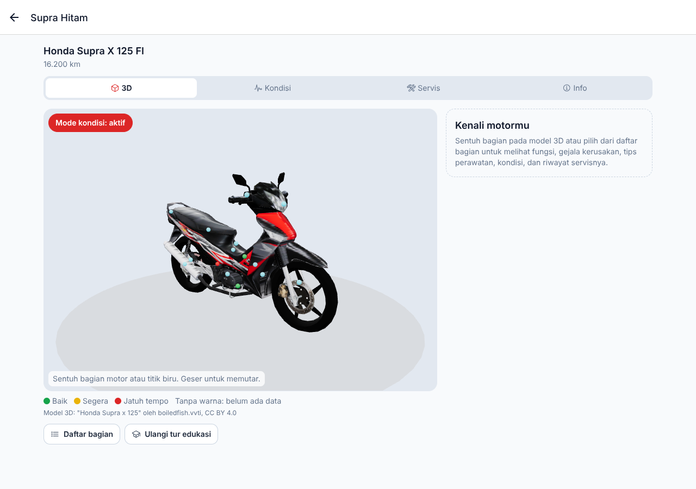
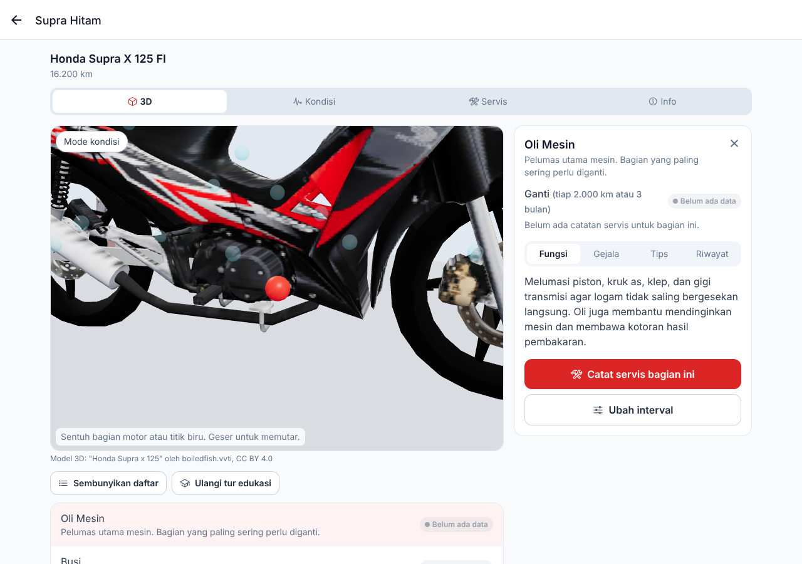

# PrimeGarage

> Pantau kondisi kendaraanmu, servis tepat waktu.

PrimeGarage adalah aplikasi garasi digital untuk mencatat riwayat servis kendaraan, mempelajari bagian-bagian kendaraan lewat model 3D interaktif, dan memperkirakan kapan setiap komponen (oli, busi, kampas rem, rantai, dan lainnya) perlu diservis atau diganti. Pengguna mendapat pengingat lewat notifikasi aplikasi dan email.

Fokus awal: **sepeda motor** (contoh acuan: Honda Supra X 125 FI). Arsitektur disiapkan untuk jenis kendaraan lain.

| Garasi | Model 3D dan mode kondisi | Info bagian |
|---|---|---|
|  |  |  |

## Platform

| Target | Cara |
|---|---|
| Android | Expo + EAS Build, output `.aab` untuk Google Play Store (`my.id.ngiliyun.primegarage`) |
| Web | Expo Web sebagai SPA di `https://primegarage.ngiliyun.my.id` (VPS aaPanel, Nginx) |
| macOS | Versi web dipasang sebagai PWA |
| iOS | Menyusul |

## Tech stack (ringkas)

- **App**: Expo SDK 58 (React Native), Expo Router, TypeScript, NativeWind, TanStack Query, React Three Fiber (3D)
- **API**: Node.js 22, NestJS 12, Prisma 7, Socket.IO (realtime), dijalankan dengan PM2
- **Database**: MySQL 8
- **Notifikasi**: Expo Push Notifications dan email SMTP Google Workspace (Nodemailer)

Detail dan alasan setiap pilihan ada di [`docs/ARCHITECTURE.md`](docs/ARCHITECTURE.md).

## Dokumentasi

| Dokumen | Isi |
|---|---|
| [PRD](docs/PRD.md) | Kebutuhan produk dan fitur |
| [Arsitektur](docs/ARCHITECTURE.md) | Tech stack, struktur repo, ADR |
| [Database](docs/DATABASE.md) | Skema MySQL dan relasi |
| [Logika Perawatan](docs/MAINTENANCE-LOGIC.md) | Rumus estimasi umur komponen dan pengingat |
| [3D Viewer](docs/3D-VIEWER.md) | Spesifikasi model 3D dan interaksi |
| [Deployment](docs/DEPLOYMENT.md) | Deploy web, API, database, dan Android |
| [Roadmap](docs/ROADMAP.md) | Fase pengerjaan |

Kontributor dan AI agent **wajib** membaca [`AGENTS.md`](AGENTS.md) sebelum mengubah kode.

## Mulai development

Butuh Node.js 22, npm 11, dan MySQL 8. Langkah lengkap ada di [`docs/DEPLOYMENT.md`](docs/DEPLOYMENT.md) bagian 8.

```bash
npx npm@11 install
```

```bash
npm run dev:api
```

```bash
npm run dev:mobile
```

Versi web saja (membuka `http://localhost:8081` di browser):

```bash
npm run dev:web
```

Buat akun login (password diminta lewat prompt):

```bash
npm run user:password -w @prime-garage/api -- --username ahmad --email ahmad@example.com --name "Ahmad"
```

## Struktur

| Folder | Isi |
|---|---|
| `apps/mobile` | Aplikasi Expo (Android, web SPA, PWA) |
| `apps/api` | API NestJS, worker pengingat, skema Prisma |
| `packages/shared` | Tipe, validasi, katalog, dan rumus perawatan yang dipakai bersama |
| `docs` | Dokumen desain (sumber kebenaran) |

## Status

MVP selesai dibangun dan teruji lokal (unit test, smoke test API, tes end-to-end web dengan Playwright). Langkah yang butuh akun dan kredensial pemilik (Google OAuth, EAS, FCM, SMTP, deploy VPS, Play Console) tercatat di [`docs/ROADMAP.md`](docs/ROADMAP.md) dengan tanda 🔑.

## Kredit

Model 3D Honda Supra X 125: "Honda Supra x 125" oleh boiledfish.vvti ([Sketchfab](https://sketchfab.com/3d-models/honda-supra-x-125-6d61abb3aa3a4161bda31ef783111015)), lisensi [CC BY 4.0](https://creativecommons.org/licenses/by/4.0/), diubah untuk PrimeGarage.

## Lisensi

MIT. Lihat [LICENSE](LICENSE).
