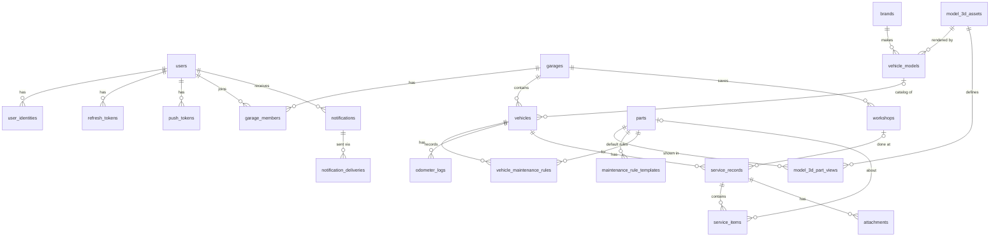

# Skema Database PrimeGarage (MySQL 8)

Setelah scaffold, sumber kebenaran teknis adalah `apps/api/prisma/schema.prisma`. Dokumen ini adalah sumber kebenaran **desain**; setiap perubahan skema wajib memperbarui dokumen ini di commit yang sama.

## 1. Konvensi

| Aturan | Nilai |
|---|---|
| Engine, charset | InnoDB, `utf8mb4`, `utf8mb4_unicode_ci` |
| Nama tabel | `snake_case`, jamak |
| Primary key data pengguna | `id CHAR(36)` berisi **UUID v7** (urut waktu, aman diekspos di URL), dibuat oleh aplikasi |
| Primary key katalog | `code VARCHAR(64)` (contoh `engine_oil`) atau `id INT UNSIGNED AUTO_INCREMENT` |
| Waktu | `DATETIME(3)` dalam **UTC**; tanggal kalender (`service_date`, `purchase_date`) memakai `DATE` |
| Uang | `DECIMAL(12,2)` dalam Rupiah |
| Jarak | `INT UNSIGNED` dalam kilometer |
| Kolom standar | `created_at`, `updated_at` di semua tabel data pengguna |
| Hapus | Hard delete dengan `ON DELETE CASCADE` sesuai relasi; kendaraan memakai `archived_at` untuk arsip |

## 2. Diagram relasi

## 3. Tabel

### 3.1 Akun dan sesi

**`users`**
| Kolom | Tipe | Catatan |
|---|---|---|
| id | CHAR(36) PK | UUID v7 |
| email | VARCHAR(191) UNIQUE | Dari penyedia identitas atau CLI |
| username | VARCHAR(50) NULL UNIQUE | Huruf kecil, untuk login password |
| password_hash | VARCHAR(255) NULL | Hash scrypt `scrypt$N$r$p$salt$hash`, tidak pernah dikirim ke klien. NULL berarti akun tanpa password |
| name | VARCHAR(120) | |
| avatar_url | VARCHAR(500) NULL | |
| timezone | VARCHAR(64) | Default `Asia/Jakarta` |
| locale | VARCHAR(10) | Default `id` |
| notify_push | BOOLEAN | Default `true` |
| notify_email | BOOLEAN | Default `true` |
| last_login_at | DATETIME(3) NULL | |
| created_at, updated_at | DATETIME(3) | |

**`user_identities`**: satu pengguna dapat menautkan beberapa penyedia login.
| Kolom | Tipe | Catatan |
|---|---|---|
| id | CHAR(36) PK | |
| user_id | CHAR(36) FK → users | CASCADE |
| provider | ENUM('google','facebook','apple','email') | |
| provider_user_id | VARCHAR(191) | `sub` dari Google |
| email | VARCHAR(191) NULL | |
| created_at | DATETIME(3) | |
| | UNIQUE(provider, provider_user_id) | |

**`refresh_tokens`**
| Kolom | Tipe | Catatan |
|---|---|---|
| id | CHAR(36) PK | |
| user_id | CHAR(36) FK → users | CASCADE |
| family_id | CHAR(36) | Satu keluarga per login; dicabut bersama jika terdeteksi pemakaian ulang |
| token_hash | CHAR(64) UNIQUE | SHA-256, token asli tidak disimpan |
| expires_at | DATETIME(3) | 30 hari |
| revoked_at | DATETIME(3) NULL | |
| replaced_by_id | CHAR(36) NULL | Token pengganti setelah rotasi |
| user_agent | VARCHAR(255) NULL | |
| ip_address | VARCHAR(45) NULL | |
| created_at | DATETIME(3) | |

**`push_tokens`**
| Kolom | Tipe | Catatan |
|---|---|---|
| id | CHAR(36) PK | |
| user_id | CHAR(36) FK → users | CASCADE |
| token | VARCHAR(255) UNIQUE | Expo push token |
| platform | ENUM('android','ios','web') | |
| device_name | VARCHAR(120) NULL | |
| last_seen_at | DATETIME(3) | Token yang ditolak Expo dihapus |
| created_at | DATETIME(3) | |

### 3.2 Garasi

**`garages`**
| Kolom | Tipe | Catatan |
|---|---|---|
| id | CHAR(36) PK | |
| owner_id | CHAR(36) FK → users | CASCADE |
| name | VARCHAR(100) | Default "Garasi {nama}" |
| created_at, updated_at | DATETIME(3) | |

**`garage_members`**
| Kolom | Tipe | Catatan |
|---|---|---|
| garage_id | CHAR(36) FK → garages | CASCADE |
| user_id | CHAR(36) FK → users | CASCADE |
| role | ENUM('owner','editor','viewer') | MVP hanya `owner` |
| created_at | DATETIME(3) | |
| | PK(garage_id, user_id) | |

### 3.3 Katalog (data referensi, di-seed)

**`brands`**
| Kolom | Tipe | Catatan |
|---|---|---|
| id | INT UNSIGNED PK AI | |
| slug | VARCHAR(64) UNIQUE | `honda` |
| name | VARCHAR(64) | `Honda` |

**`model_3d_assets`**
| Kolom | Tipe | Catatan |
|---|---|---|
| key | VARCHAR(64) PK | `underbone_v1` |
| category | ENUM kategori (lihat `vehicle_models.category`) | |
| file_path | VARCHAR(255) | Path aset di app atau URL CDN |
| version | SMALLINT UNSIGNED | Naik setiap file diganti |
| license_note | VARCHAR(500) | Sumber dan lisensi model |
| is_active | BOOLEAN | |

**`vehicle_models`**
| Kolom | Tipe | Catatan |
|---|---|---|
| id | INT UNSIGNED PK AI | |
| brand_id | INT UNSIGNED FK → brands | |
| name | VARCHAR(100) | `Supra X 125 FI` |
| slug | VARCHAR(120) UNIQUE | `honda-supra-x-125-fi` |
| kind | ENUM('motorcycle','car') | |
| category | ENUM('underbone','scooter','sport','trail','car_hatchback','car_sedan','car_mpv','car_suv','other') | `underbone` = motor bebek |
| engine_cc | SMALLINT UNSIGNED | |
| fuel_system | ENUM('carburetor','injection') NULL | |
| transmission | ENUM('manual','semi_automatic','automatic') NULL | Bebek = `semi_automatic` |
| final_drive | ENUM('chain','belt','shaft') NULL | Menentukan komponen yang relevan |
| year_start, year_end | SMALLINT UNSIGNED NULL | |
| model_3d_key | VARCHAR(64) FK → model_3d_assets | |
| specs | JSON NULL | Kapasitas oli, ukuran ban, tipe busi, dll. |
| is_active | BOOLEAN | |

**`parts`**: katalog komponen sekaligus konten edukasi (FR-EDU-02).
| Kolom | Tipe | Catatan |
|---|---|---|
| code | VARCHAR(64) PK | `engine_oil`, lihat daftar di `docs/3D-VIEWER.md` |
| name | VARCHAR(100) | `Oli Mesin` |
| name_en | VARCHAR(100) | `Engine Oil` |
| group | ENUM('engine','fuel','drivetrain','brake','electrical','suspension','wheel','body','fluid') | Kolom ini perlu di-quote di SQL (`group` kata kunci) atau dipetakan di Prisma sebagai `partGroup` |
| applies_to | JSON | Daftar kategori, contoh `["underbone","scooter","sport"]` |
| summary | VARCHAR(255) | Satu kalimat untuk tur edukasi |
| function_text | TEXT | Fungsi bagian |
| symptoms_text | TEXT | Gejala jika bermasalah |
| care_tips_text | TEXT | Tips perawatan |
| tour_order | SMALLINT NULL | Urutan di tur edukasi; NULL = tidak masuk tur |
| sort_order | SMALLINT | |

**`model_3d_part_views`**: posisi kamera dan label per bagian pada satu model 3D.
| Kolom | Tipe | Catatan |
|---|---|---|
| model_3d_key | VARCHAR(64) FK → model_3d_assets | |
| part_code | VARCHAR(64) FK → parts | |
| camera_position | JSON | `[x, y, z]` |
| camera_target | JSON | `[x, y, z]` |
| label_anchor | JSON NULL | Titik label `[x, y, z]` |
| | PK(model_3d_key, part_code) | |

**`maintenance_rule_templates`**: interval default.
| Kolom | Tipe | Catatan |
|---|---|---|
| id | INT UNSIGNED PK AI | |
| part_code | VARCHAR(64) FK → parts | |
| action | ENUM tindakan (lihat `service_items.action`) | `replace` atau `inspect`, dll. |
| category | ENUM kategori NULL | Berlaku untuk satu kategori |
| vehicle_model_id | INT UNSIGNED NULL FK → vehicle_models | Lebih spesifik, menang atas `category` |
| interval_km | INT UNSIGNED NULL | |
| interval_months | SMALLINT UNSIGNED NULL | Minimal salah satu interval terisi |
| reset_actions | JSON | Tindakan yang mereset baseline, contoh `["replace"]` |
| source_note | VARCHAR(255) | Contoh "Estimasi umum, verifikasi buku servis" |

### 3.4 Kendaraan

**`vehicles`**
| Kolom | Tipe | Catatan |
|---|---|---|
| id | CHAR(36) PK | |
| garage_id | CHAR(36) FK → garages | CASCADE |
| vehicle_model_id | INT UNSIGNED NULL FK → vehicle_models | NULL jika diisi manual (FR-VEH-03) |
| kind | ENUM('motorcycle','car') | |
| category | ENUM kategori | Disalin dari model atau dipilih manual |
| custom_brand | VARCHAR(64) NULL | Untuk input manual |
| custom_model | VARCHAR(100) NULL | Untuk input manual |
| nickname | VARCHAR(60) | Contoh "Supra Hitam" |
| plate_number | VARCHAR(20) NULL | |
| year | SMALLINT UNSIGNED NULL | |
| color | VARCHAR(40) NULL | |
| engine_cc | SMALLINT UNSIGNED NULL | |
| frame_number | VARCHAR(40) NULL | Nomor rangka |
| engine_number | VARCHAR(40) NULL | |
| purchase_date | DATE NULL | |
| initial_odometer_km | INT UNSIGNED | Saat kendaraan didaftarkan |
| current_odometer_km | INT UNSIGNED | Cache dari `odometer_logs` terbaru |
| current_odometer_at | DATETIME(3) | |
| model_3d_key | VARCHAR(64) FK → model_3d_assets | Hasil resolusi model atau kategori |
| photo_attachment_id | CHAR(36) NULL | |
| edu_tour_completed_at | DATETIME(3) NULL | FR-EDU-01 |
| archived_at | DATETIME(3) NULL | |
| created_by | CHAR(36) FK → users | |
| created_at, updated_at | DATETIME(3) | |
| | INDEX(garage_id, archived_at) | |

**`vehicle_maintenance_rules`**: disalin dari template saat kendaraan dibuat, dapat diubah pengguna (FR-MNT-02).
| Kolom | Tipe | Catatan |
|---|---|---|
| id | CHAR(36) PK | |
| vehicle_id | CHAR(36) FK → vehicles | CASCADE |
| part_code | VARCHAR(64) FK → parts | |
| action | ENUM tindakan | |
| interval_km | INT UNSIGNED NULL | |
| interval_months | SMALLINT UNSIGNED NULL | |
| reset_actions | JSON | |
| is_enabled | BOOLEAN | |
| template_id | INT UNSIGNED NULL | Asal template |
| is_customized | BOOLEAN | `true` jika diubah pengguna |
| snoozed_until | DATE NULL | FR-NTF-05 |
| created_at, updated_at | DATETIME(3) | |
| | UNIQUE(vehicle_id, part_code, action) | |

**`odometer_logs`**
| Kolom | Tipe | Catatan |
|---|---|---|
| id | CHAR(36) PK | |
| vehicle_id | CHAR(36) FK → vehicles | CASCADE |
| km | INT UNSIGNED | |
| recorded_at | DATETIME(3) | |
| source | ENUM('initial','manual','service') | |
| service_record_id | CHAR(36) NULL UNIQUE FK → service_records | CASCADE; satu log odometer per servis |
| note | VARCHAR(255) NULL | |
| created_by | CHAR(36) FK → users | |
| created_at | DATETIME(3) | |
| | INDEX(vehicle_id, recorded_at) | |

### 3.5 Bengkel dan servis

**`workshops`**
| Kolom | Tipe | Catatan |
|---|---|---|
| id | CHAR(36) PK | |
| garage_id | CHAR(36) FK → garages | CASCADE; MVP bengkel bersifat privat per garasi |
| name | VARCHAR(120) | Contoh "Garam Motor" |
| type | ENUM('official','general','self','other') | `official` = dealer resmi/AHASS, `general` = bengkel umum, `self` = servis sendiri |
| certification | ENUM('certified','not_certified','unknown') | Default `unknown` |
| certification_note | VARCHAR(255) NULL | |
| address | VARCHAR(255) NULL | |
| city | VARCHAR(100) NULL | |
| phone | VARCHAR(30) NULL | |
| latitude, longitude | DECIMAL(9,6) NULL | |
| notes | TEXT NULL | |
| created_by | CHAR(36) FK → users | |
| created_at, updated_at | DATETIME(3) | |

**`service_records`**
| Kolom | Tipe | Catatan |
|---|---|---|
| id | CHAR(36) PK | |
| vehicle_id | CHAR(36) FK → vehicles | CASCADE |
| workshop_id | CHAR(36) NULL FK → workshops | SET NULL |
| service_date | DATE | |
| odometer_km | INT UNSIGNED | Otomatis membuat `odometer_logs` dengan source `service` |
| mechanic_name | VARCHAR(100) NULL | |
| labor_cost | DECIMAL(12,2) NULL | Ongkos jasa |
| total_cost | DECIMAL(12,2) | Jumlah subtotal item + jasa (dihitung API) |
| notes | TEXT NULL | |
| created_by | CHAR(36) FK → users | |
| created_at, updated_at | DATETIME(3) | |
| | INDEX(vehicle_id, service_date) | |

**`service_items`**
| Kolom | Tipe | Catatan |
|---|---|---|
| id | CHAR(36) PK | |
| service_record_id | CHAR(36) FK → service_records | CASCADE |
| part_code | VARCHAR(64) NULL FK → parts | NULL jika teks bebas |
| custom_part_name | VARCHAR(100) NULL | Wajib jika `part_code` NULL |
| action | ENUM('replace','top_up','inspect','adjust','clean','lubricate','repair','other') | ganti, tambah, periksa, setel, bersihkan, lumasi, perbaiki, lainnya |
| product_name | VARCHAR(120) NULL | Contoh "Federal Supreme XX 10W-30" |
| quantity | DECIMAL(10,2) NULL | |
| unit | VARCHAR(20) NULL | `L`, `pcs`, `set` |
| unit_price | DECIMAL(12,2) NULL | |
| subtotal | DECIMAL(12,2) NULL | |
| notes | VARCHAR(255) NULL | |
| sort_order | SMALLINT | Urutan tampil item |
| | INDEX(part_code) | Untuk mencari baseline komponen |

**`attachments`**
| Kolom | Tipe | Catatan |
|---|---|---|
| id | CHAR(36) PK | |
| garage_id | CHAR(36) FK → garages | CASCADE; dipakai untuk otorisasi |
| owner_type | ENUM('service_record','vehicle') | |
| owner_id | CHAR(36) | |
| file_path | VARCHAR(255) | Relatif terhadap direktori storage |
| mime_type | VARCHAR(50) | |
| size_bytes | INT UNSIGNED | |
| width, height | SMALLINT UNSIGNED NULL | |
| created_by | CHAR(36) FK → users | |
| created_at | DATETIME(3) | |

### 3.6 Notifikasi

**`notifications`**
| Kolom | Tipe | Catatan |
|---|---|---|
| id | CHAR(36) PK | |
| user_id | CHAR(36) FK → users | CASCADE |
| vehicle_id | CHAR(36) NULL FK → vehicles | CASCADE |
| rule_id | CHAR(36) NULL FK → vehicle_maintenance_rules | CASCADE |
| type | ENUM('component_soon','component_due','odometer_stale','system') | |
| title | VARCHAR(150) | |
| body | VARCHAR(500) | |
| data | JSON NULL | Deep link, snapshot status |
| dedupe_key | VARCHAR(191) UNIQUE | Mencegah notifikasi ganda, lihat `docs/MAINTENANCE-LOGIC.md` |
| read_at | DATETIME(3) NULL | |
| created_at | DATETIME(3) | |

**`notification_deliveries`**
| Kolom | Tipe | Catatan |
|---|---|---|
| id | CHAR(36) PK | |
| notification_id | CHAR(36) FK → notifications | CASCADE |
| channel | ENUM('push','email') | |
| status | ENUM('pending','sent','failed','skipped') | |
| attempts | TINYINT UNSIGNED | Maks 3 |
| error | VARCHAR(500) NULL | |
| sent_at | DATETIME(3) NULL | |
| created_at | DATETIME(3) | |

## 4. Otorisasi data

MySQL tidak punya Row Level Security, jadi otorisasi **wajib** di API:

1. Setiap request terautentikasi membawa `userId` dari JWT.
2. Setiap akses ke `vehicles`, `workshops`, `attachments`, dan turunannya harus melewati pengecekan: ada baris `garage_members` dengan `garage_id` terkait dan `user_id = userId`.
3. Implementasi: `GarageAccessGuard` / helper `assertGarageAccess(userId, garageId, minimumRole)` di NestJS. Query Prisma selalu menyertakan filter `garage: { members: { some: { userId } } }`.
4. Hak per peran:

| Aksi | owner | editor | viewer |
|---|---|---|---|
| Lihat kendaraan, servis, kondisi | ya | ya | ya |
| Tambah/ubah odometer dan servis | ya | ya | tidak |
| Tambah/ubah/hapus kendaraan | ya | ya | tidak |
| Kelola anggota, hapus garasi | ya | tidak | tidak |

5. Respons untuk sumber daya milik garasi lain adalah **404** (bukan 403) agar keberadaan data tidak bocor.

## 5. Penghapusan akun (FR-AUTH-04)

Dalam satu transaksi: hapus semua garasi yang dimiliki pengguna (cascade ke kendaraan, servis, bengkel, lampiran), hapus keanggotaan di garasi lain, lalu hapus `users` (cascade ke identitas, token, notifikasi). File lampiran dihapus dari disk setelah transaksi berhasil.

## 6. Data awal (seed)

- `brands`: Honda, Yamaha, Suzuki, Kawasaki, TVS, Vespa/Piaggio.
- `vehicle_models`: minimal Honda Supra X 125 FI (kategori `underbone`), ditambah model populer lain secara bertahap.
- `model_3d_assets`: `underbone_v1` dan `honda_supra_x_125_fi_v1` (dipakai katalog Supra X 125 dan Supra X 125 FI).
- `parts`, `model_3d_part_views`, `maintenance_rule_templates`: sesuai `docs/3D-VIEWER.md` dan `docs/MAINTENANCE-LOGIC.md`.

Sumber data seed ada di `packages/shared/src/catalog/`; skrip seed: `apps/api/prisma/seed.ts` (`npm run db:seed`).
